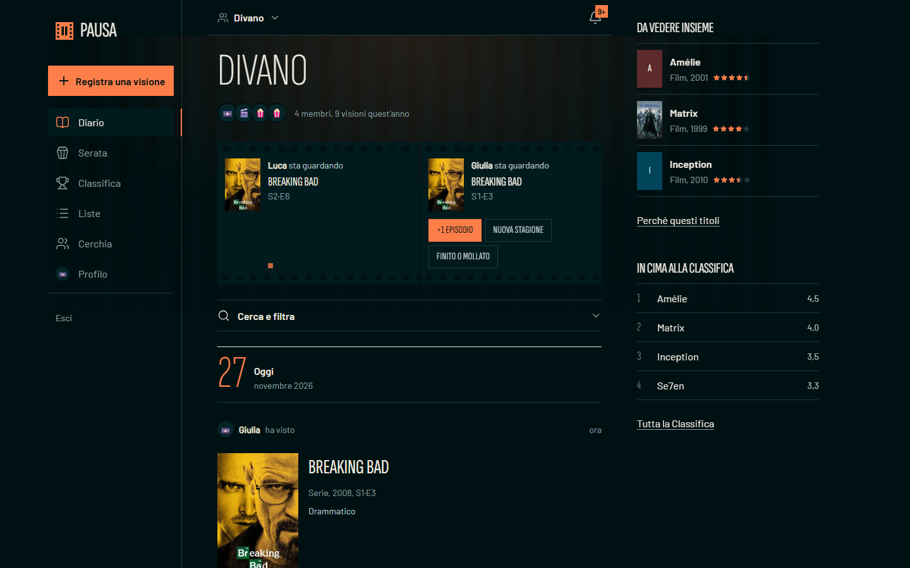
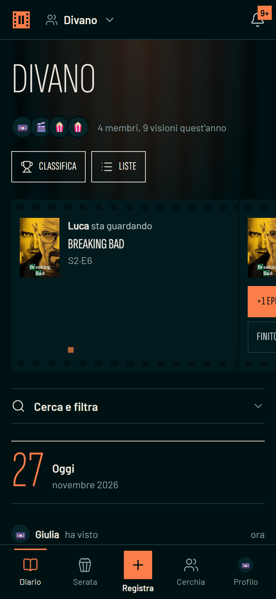
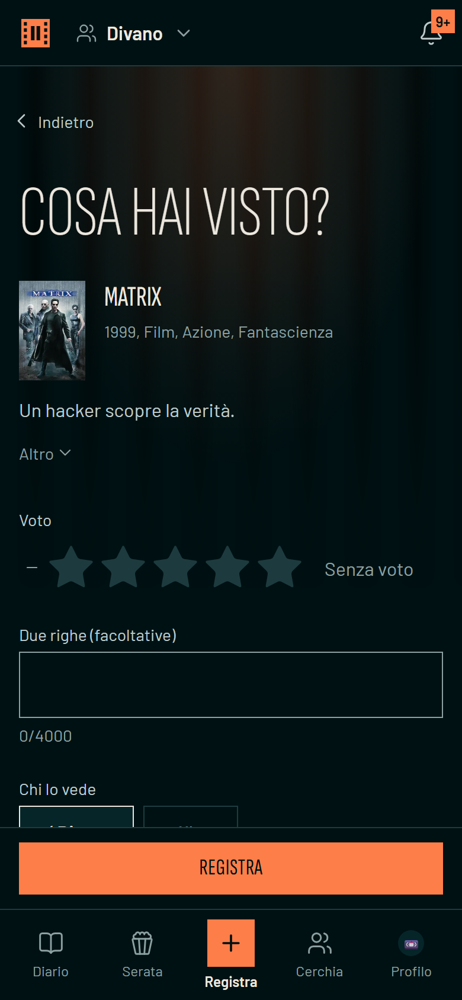
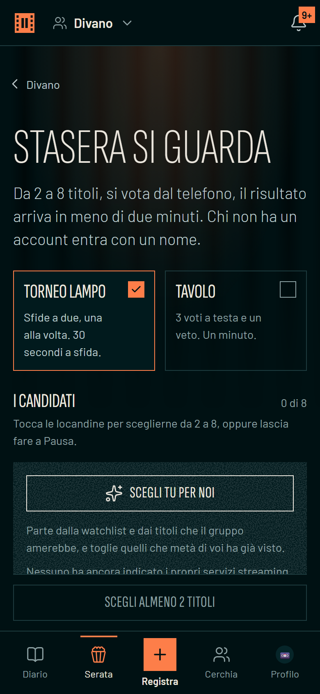
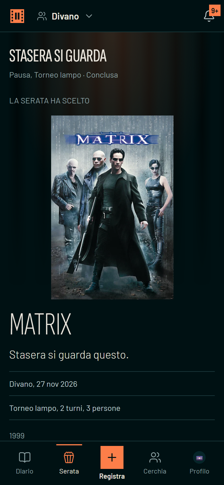
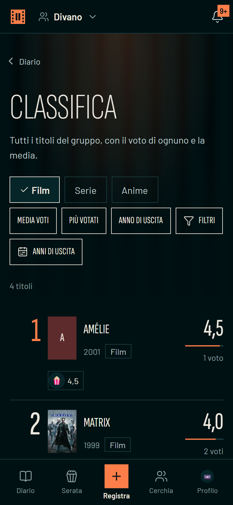
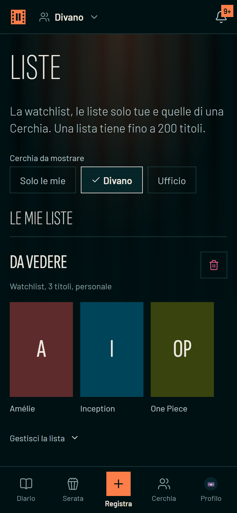
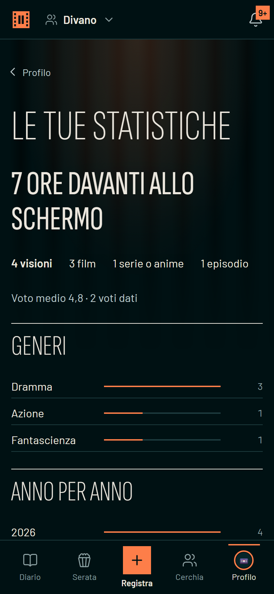

# Pausa

**Cosa guardiamo stasera? Deciso in due minuti.**

Pausa è il diario privato di film, serie e anime di un gruppo di amici: i voti di tutti in un posto solo, e la **Serata**, un voto di gruppo che sceglie cosa guardare. È online su [pausa.gnagno.org](https://pausa.gnagno.org), in italiano, inglese e spagnolo.



| Diario | Registra | Serata | Risultato |
|:---:|:---:|:---:|:---:|
|  |  |  |  |
| **Classifica** | **Liste** | **Profilo** | **Statistiche** |
|  |  |  |  |

<sub>Screenshot dall'ambiente locale, con dati di prova. Locandine e dati dei titoli: TMDB. Pausa usa l'API di TMDB ma non è approvata né certificata da TMDB.</sub>

## Come funziona

1. **Crei una Cerchia** e mandi il link d'invito (o il QR). Chi entra vede solo il diario di quel gruppo.
2. **Registrate quello che guardate**: voto a mezze stelle, due righe, spoiler nascosti, con chi eravate, chi può vederlo (una Cerchia, più Cerchie o solo voi).
3. **Aprite una Serata** con una rosa di 2–8 titoli. Si vota dal telefono, anche senza account:
   - **Torneo lampo**: sfide a due, 30 secondi l'una;
   - **Tavolo**: 3 voti a testa e un veto.
4. Esce il titolo, con una Card da condividere che non rivela chi ha votato cosa.

### Cosa c'è dentro

| Area | Funzioni |
|---|---|
| **Cerchie** | inviti con scadenza e limite di posti, QR, ruoli, trasferimento di proprietà, silenzia e nascondi |
| **Diario** | feed per giorno, ricerca e filtri, reazioni, commenti con risposte, "sta guardando", "un anno fa", primi passi, scrittura anche senza rete |
| **Titoli** | ricerca per titolo, regista o autore; scheda con cast, stagioni, "dove guardarlo" |
| **Gruppo** | classifica con filtri, affinità tra i membri, anno in rassegna, "Da vedere insieme" |
| **Personale** | profilo, preferiti, liste e watchlist, "Per te", statistiche, traguardi |
| **Facoltativo** | pagina pubblica del profilo e classifica globale: solo per chi sceglie di entrare |
| **Importazione** | Letterboxd, IMDb, Trakt, Cinemaniac, AniList, MyAnimeList |
| **Account** | link via email o Google, sessioni attive, esportazione dei dati, eliminazione, notifiche push |

La privacy è la regola: niente è pubblico, salvo quello che una persona sceglie di pubblicare.

## Com'è fatta

```
 Browser · PWA · Android
        │
        ├── pagine pubbliche e app (file statici) ──► Cloudflare Workers Assets
        │
        └── /api/* (JSON) ──► un solo Worker in Rust
                                  ├── D1            dati e sessioni
                                  ├── Durable Object la stanza della Serata (WebSocket)
                                  ├── crates/engine raccomandazioni
                                  ├── crates/og     immagini di anteprima dei link
                                  └── TMDB · AniList · Resend · Web Push
```

| Cartella | Contenuto |
|---|---|
| `crates/api` | API su Cloudflare Workers: rotte, accesso, D1, Durable Object della Serata |
| `crates/core` | logica pura (visibilità, classifica, Serata, limiti, traguardi), testata senza rete |
| `crates/engine` | motore di raccomandazione |
| `crates/og` | immagini Open Graph disegnate in Rust |
| `apps/mobile` | client Expo: Android e web (vedi il suo README) |
| `packages/api-types` | tipi TypeScript **generati** dal Rust |
| `packages/messages` | testi it/en/es |
| `migrations/` | schema D1 |
| `tools/` | ambiente locale, smoke test, migrazione dati dalla v1 |
| `docs/` | messa online (`DEPLOY.md`) e documenti del rifacimento (`rebuild/`) |
| `DESIGN.md`, `design/` | sistema visivo "Darkroom" |

### La storia

La prima versione era in **Next.js** (OpenNext) sugli stessi Workers. Il rendering a ogni richiesta superava il limite di CPU del piano gratuito (errore Cloudflare 1102): il rimedio è stato prerenderizzare le pagine pubbliche, ma il problema di fondo restava. A fine novembre 2026 l'app è stata riscritta in Rust ed Expo. Il codice della prima versione è sul ramo `legacy` e resta il riferimento per aspetto e comportamento.

### Perché questi strumenti

Il vincolo che decide tutto: **costo zero**. Il piano gratuito di Cloudflare dà 10 ms di CPU per richiesta e 100.000 richieste al giorno (numeri e stime in `docs/rebuild/BUDGET.md`).

| Scelta | Perché | Cosa costa in cambio |
|---|---|---|
| **Rust** sul Worker | Poca CPU per richiesta, avvio rapido, errori trovati in compilazione, logica testabile con `cargo test` | Compilazione più lenta, meno librerie pronte: l'accesso è scritto in casa |
| **Cloudflare Workers + D1** | Gratis, un solo deploy, file statici senza limite di richieste | Limiti giornalieri di D1; vanno contate le righe lette |
| **Durable Object** (SQLite) | Una stanza per Serata, con il server che tiene il tempo e i WebSocket | È il solo tipo disponibile nel piano gratuito |
| **Expo / React Native + Web** | Un solo codice per Android e web | Bundle web pesante: c'è un tetto controllato in CI (350 KB), oggi quasi pieno |
| **Pagine pubbliche statiche** | Indicizzabili e veloci, quasi senza JavaScript | Passo di post-esportazione scritto a mano |
| **`ts-rs`** | I tipi delle risposte nascono dal Rust, non si scrivono due volte | I corpi delle richieste sono ancora dichiarati a mano |
| **PWA su iPhone** | Nessuna quota Apple Developer (99 $ l'anno) | Niente App Store |
| **Resend** per le email | Piano gratuito sufficiente per i link di accesso | 100 email al giorno |
| **TMDB e AniList** | Locandine, schede e disponibilità; AniList copre gli anime | Attribuzione obbligatoria e limiti di richiesta |

## Sviluppo locale

Servono **Node 24** (come in CI; con Node più vecchi di 22.18 la build web si ferma in `postexport`), **Rust** con il target `wasm32-unknown-unknown` e `worker-build`:

```bash
rustup target add wasm32-unknown-unknown
cargo install worker-build --version 0.9.0 --locked
```

Poi:

```bash
npm ci                                   # wrangler (radice)
cd apps/mobile && npm ci && npm run build:web && cd ../..
node tools/dev-stack.mjs --seed          # http://localhost:8798, catalogo finto e dati di prova
```

Per entrare come una persona di prova (`giulia`, `marco`, `anna`, `luca`):

```bash
node tools/dev-login.mjs http://localhost:8798 giulia@pausa.test
```

Dopo aver ricompilato il client, riavvia `dev-stack`.

### Verifiche

```bash
cargo test --workspace                   # test Rust, rigenera packages/api-types
node tools/run-smoke.mjs                 # smoke dell'API sul Worker compilato
cd apps/mobile && npm run check          # tipi, test unitari, build, budget, end-to-end
```

## Messa online

**Attenzione: ogni push su `main` va in produzione** (`.github/workflows/deploy.yml`: build, migrazioni D1, deploy). Lavora su un branch e unisci solo dopo la revisione. Variabili e segreti sono descritti in `docs/DEPLOY.md`.

## Cosa manca

Aggiornato al 27 novembre 2026.

**Da chiarire per primo**
- La migrazione dei dati veri dalla v1 **non risulta eseguita**: la v1 usava il database `pausa`, la nuova `pausa-v2`. Lo script (`tools/migrate-v1-to-v2/`) è stato provato solo su dati finti.

**Mai provato dal vero**
- Link di accesso ricevuto in una casella vera, accesso con Google in produzione, notifiche push.
- Telefono Android fisico, app installata su iPhone, una Serata fra persone e telefoni veri.
- CPU per richiesta e costi misurati in produzione.

**Da fare**
- AAB firmato per il test chiuso di Google Play.
- Attivare Sentry (manca il segreto `SENTRY_DSN`).
- Altre guide oltre a quella pubblicata.
- Filtro per i nomi offensivi nella classifica globale.
- Confronto visivo schermata per schermata con la v1.

Il dettaglio è in `docs/rebuild/CONFRONTO.md`.

## Licenza

Codice proprietario, tutti i diritti riservati: vedi [LICENSE](LICENSE).
